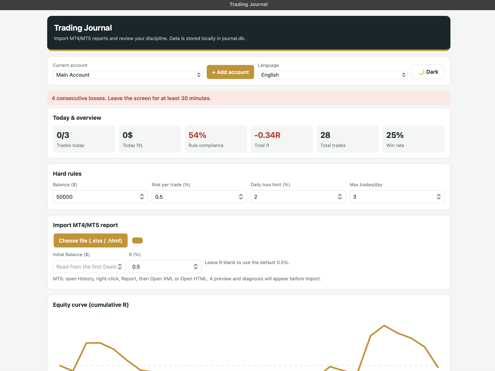
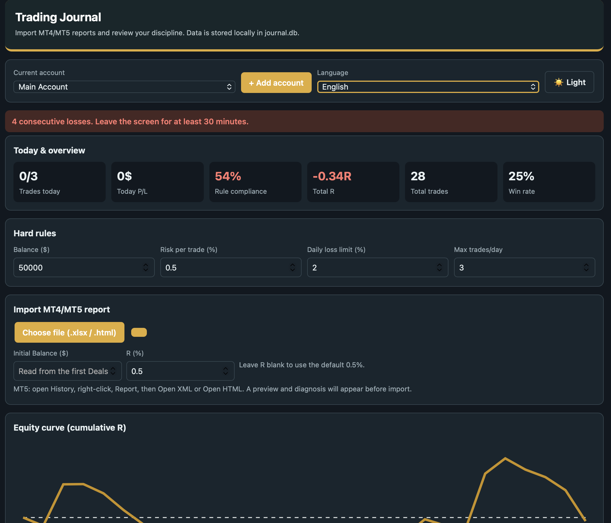

# Trading Journal

Trading Journal is a local desktop application for importing MT4/MT5 reports, reviewing trading discipline, and tracking risk across multiple trading accounts.

The application is designed to keep trading data on the user's computer. It supports Vietnamese and English, light and dark mode, manual trade entry, and account-specific settings.

## Features

- Import MT4/MT5 `.xlsx`, `.html`, and `.htm` reports.
- Read the initial balance from the first row of the MT5 Deals table when available.
- Calculate risk per trade from the initial balance and the selected risk percentage.
- Default risk: `0.5%`.
- Edit the initial balance and risk percentage before importing.
- Support multiple trading accounts.
- Add trades manually without importing a report.
- Track profit/loss, risk, R-multiple, setup compliance, emotions, violations, and notes.
- Export the selected account's trades to Excel.
- Vietnamese and English interface.
- Light and dark mode.
- Local SQLite storage; no cloud service is required.

## Screenshots

Place project screenshots in `docs/screenshots/` using these filenames:

| Light mode | Dark mode |
|---|---|
|  |  |

The screenshots can show the account selector, risk settings, manual trade form, import preview, and trade history table.

## Requirements

- Python 3.10 or newer
- A supported desktop operating system: macOS, Windows, or Linux
- Internet access during the first setup to install Python packages

## Run from Source

### macOS and Linux

```bash
python3 -m venv .venv
source .venv/bin/activate
pip install -r requirements.txt
pip install pywebview
python app.py
```

If `pywebview` is not installed, the application opens in the default web browser instead of a native desktop window.

### Windows

```bat
py -m venv .venv
.venv\Scripts\activate
pip install -r requirements.txt
pip install pywebview
python app.py
```

The application normally starts on `http://127.0.0.1:5001`. If that port is busy, it automatically selects the next available port.

## Build Desktop Applications

Build on the operating system where the application will run. PyInstaller does not reliably cross-compile native applications between macOS, Windows, and Linux.

### macOS

```bash
./build_mac.sh
```

Output:

```text
dist/Trading Journal.app
```

### Linux

```bash
./build_linux.sh
```

Output:

```text
dist/Trading Journal/Trading Journal
```

### Windows

Double-click `build_windows.bat`, or run it from Command Prompt:

```bat
build_windows.bat
```

Output:

```text
dist\Trading Journal\Trading Journal.exe
```

The Windows script uses `icon.ico` if it exists in the project root. Otherwise, it builds without a custom Windows icon.

## Data Storage

When running from source, the local database is stored as:

```text
journal.db
```

When running a packaged macOS application, the database is stored in:

```text
~/Library/Application Support/TradingJournal/journal.db
```

The database contains accounts, account settings, and trades. Back up the database before manually editing or removing it.

## Risk Calculation

During import, the application uses the following formula:

```text
Risk per trade = Initial Balance × Risk percentage / 100
```

Example:

```text
Initial Balance = 50,000
Risk percentage = 0.5%
Risk per trade = 250
```

If the report does not contain an initial balance, the application uses the balance saved in the selected account. The initial balance and risk percentage can be edited before confirming the import.

## Project Structure

```text
app.py              Flask application and API routes
mtparse.py          MT4/MT5 report parser
static/index.html   Desktop/web user interface
static/favicon.svg  Theme-aware application favicon
requirements.txt    Python dependencies
build_mac.sh        macOS build script
build_linux.sh      Linux build script
build_windows.bat   Windows build script
```

## Notes

The current application imports reports and supports manual entry. It does not place orders or connect directly to a broker account. Any future broker integration should start with read-only access.

## License

Copyright © 2026 Vinh Huynh. All rights reserved.
